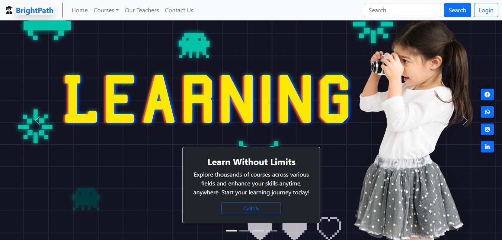

<p align="center">
  
</p>

# 🎓 BrightPath Learning

A modern, fully responsive e-learning platform interface for web development courses, built with HTML5, CSS3, and Bootstrap.

🔗 **Live Demo:** [dev-ahmedissa.github.io/bright-path-learning](https://dev-ahmedissa.github.io/bright-path-learning/)

## 📸 Preview



## ✨ Features

- Fully responsive layout that adapts to mobile, tablet, and desktop screens
- Navigation bar with a courses dropdown menu and login form
- Hero slider introducing the main learning tracks
- Course sections: HTML & CSS, JavaScript, React, Full-Stack, Next.js, Tailwind CSS
- Video cards for each learning track
- Instructors section and learning news cards
- Subscription sections and a detailed footer

## 🛠️ Built With

- HTML5
- CSS3
- Bootstrap

## 🚀 Run Locally

```bash
git clone https://github.com/dev-ahmedissa/bright-path-learning.git
cd bright-path-learning
```

Then open `index.html` in your browser.

## 📬 Contact

**Ahmed Issa**, Frontend Developer
[ahmednashatissa@gmail.com](mailto:ahmednashatissa@gmail.com) • [GitHub](https://github.com/dev-ahmedissa)
